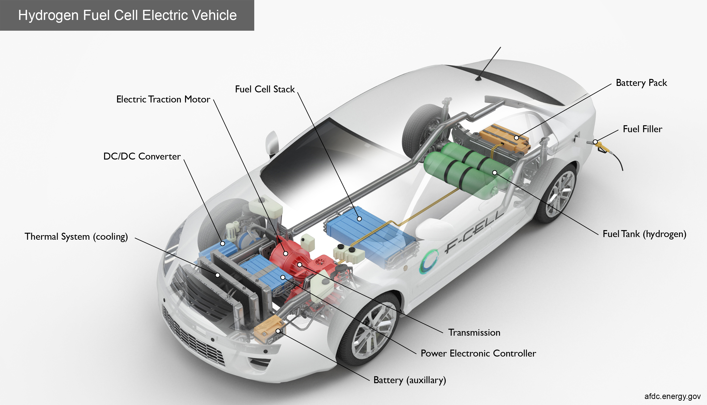
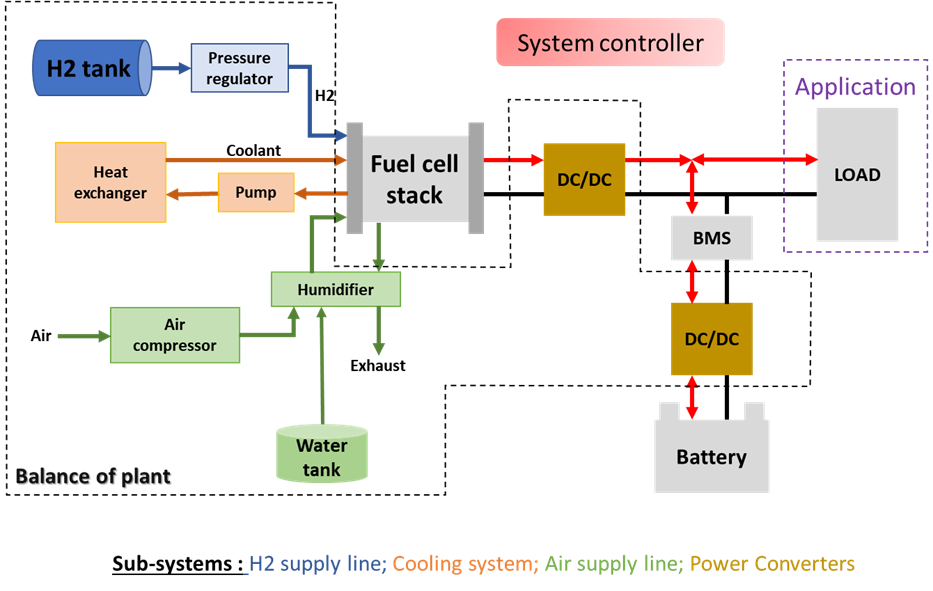

# VirtualFCS Library
VirtualFCS is an open Modelica library for dynamic modelling of hydrogen and hybrid energy systems. It brings together electrochemical, electrical, fluid, thermal, control, and vehicle models, with examples ranging from PEM fuel cell vehicles to ammonia cracking.

Note that this library might also work with other platforms that win64, but that is not tested during development.

<b>Citing other library versions</b>

Note that library versions older than v2.0.0 requires OpenModelica v1.14.

|  Released  | Version       | DOI |
|------------|---------------|-----|
| 2023-01-19 | v2.0.0        |  |
| 2022-02-16 | v2022.1.0-beta|  |
| 2021-12-15 | v0.2.1-beta   |  |
| 2021-09-22 | v0.2.0-beta   |  |
| 2021-07-01 | v0.1.0-beta   |     |

## Library Description

The objective of the complete hybrid system model is to reproduce and simulate the dynamic behavior of all the components according to the desired architecture. Depending on the possibilities, degradation mechanisms of the components will be considered in order to predict the performance losses of the entire system.

 

Here is the library examplified with transport application. However, the library is well suited for other applications, such as stationary systems, electrolysers, and ammonia cracking. Under a fuel cell-battery hybrid electric vehicle, and a general layout of its propulsion system can be seen. Example of this application can be found in the library.

### The library contains:

- **Electrochemical systems:** PEM fuel cells and stacks, fuel-cell systems, batteries, and PEM electrolysers.
- **Balance of plant:** hydrogen, air, and cooling subsystems, compressors, humidifiers, heat exchangers, and related controls.
- **System integration:** battery-electric and fuel cell range-extender powertrains.
- **Other applications:** ammonia-cracking system case study, vehicle drive cycles, hardware-, software-, and user-in-the-loop examples.

## System Requirements and Installation
The VirtualFCS library is designed to work with OpenModelica and supports versions from 1.20 to 1.27, and Modelica Standard Library 4.1.0. To install OpenModelica, please visit their website:

[Information about OpenModelica](https://www.openmodelica.org/) 
[Download OpenModelica v1.27 for Windows](https://build.openmodelica.org/omc/builds/windows/releases/1.27/1/) 
[OpenModelica on GitHub](https://github.com/OpenModelica) 

To use the VirtualFCS library, follow these steps:
1. Clone this repository to your computer
2. Open the OpenModelica Connection Editor
3. Open the file VirtualFCS\package.mo
4. The VirtualFCS library will load in the library browser on the left of the Connection Editor

Development and conventions
------------------------

### Workflow
The VirtualFCS library is currently in development by members of BeBoP, SURFER, MiNaMi projects. Development should always take place on a side branch. Never pull to main. Contributions submitted as [Pull Requests](https://github.com/Virtual-FCS/VirtualFCS/pulls) are welcome. Recommended git comment method for contributors can be found here: [How to Write a Git Commit Message](https://cbea.ms/git-commit/). 

Issues can be reported using the [Issues](https://github.com/Virtual-FCS/VirtualFCS/issues) button. 

### Naming conventions
Naming conventions are laid out below:

Classes. Classes should be nouns in UpperCamelCase (e.g. FuelCellStack). 
Instance. Instance names should be nouns in lowerCamelCase. An underscore at the end of the name may be used to characterize an upper or lower index (e.g. automotiveStack, pin_a). 
Method. Methods should be verbs in lowerCamelCase (e.g. updateFuelCellStack). 
Variables. Local variables, instance variables, and class variables are also written either as single letters or in lowerCamelCase (e.g. U, cellVoltage). 
Constants. Constants should be written in uppercase characters separated by underscores (e.g. T_REF). 

License
-------
Virtual-FCS is shared under a MIT license. For more information, please see the file LICENSE.

Attributions and credits
------------------------

### Contributors (in alphabetical order)
Amelie Pinard, 		SINTEF Industry, Trondheim, Norway 
Benjamin Synnevåg, 		SINTEF Industry, Trondheim, Norway 
Dr. Daniel Pérez Clos,	SINTEF Industry, Trondheim, Norway 
Dr. Federico Zenith, 	SINTEF Digital, Trondheim, Norway 
Dr. Karim Bendiub, SINTEF Industry, Trondheim, Norway 
Dr. Loic Vichard, 	UBFC, Belfort, France 
Dr. Mike Gerhardt, 	SINTEF Industry, Trondheim, Norway 
Dr. Nadia Steiner, 	UBFC, Belfort, France 
Dr. Roberto Scipioni, 	SINTEF Industry Trondheim, Norway 
Dr. Simon Clark, 	SINTEF Industry, Trondheim, Norway 
Dr. Yash Raka, 		SINTEF Industry, Trondheim, Norway 

### Projects
- [Virtual-FCS](http://www.virtual-fcs.eu/); Grant Agreement No 875087.
- [BeBoP](https://bebop-hydrogen.eu/); Grant Agreement No 101192365.
- [MiNaMi](https://minami-project.eu/); Grant Agreement No 101250260. 
- [SURFER](https://h2surfer.eu/); Grant Agreement No 101250344. 

### Acknowledgements
  This code repository is part of a project that has received funding from the Clean Hydrogen (formerly Fuel Cells and Hydrogen 2) Joint Undertaking under Grant Agreements No 875087, 101192365, 101250260, and 101250344. This Joint Undertaking receives support from the European Union’s Horizon 2020 Research and Innovation programme, Hydrogen Europe and Hydrogen Europe Research.
